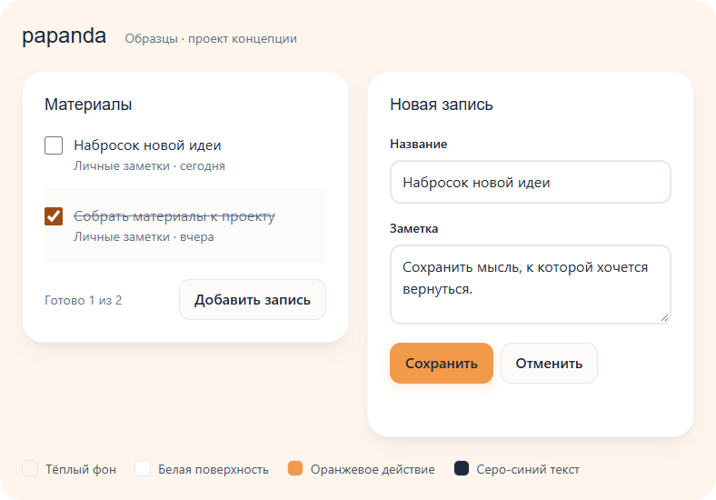
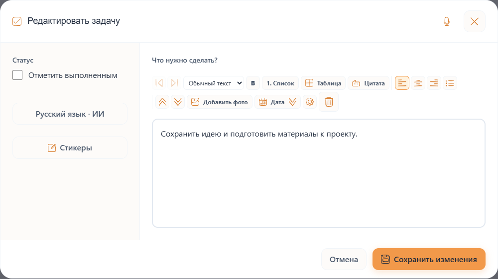
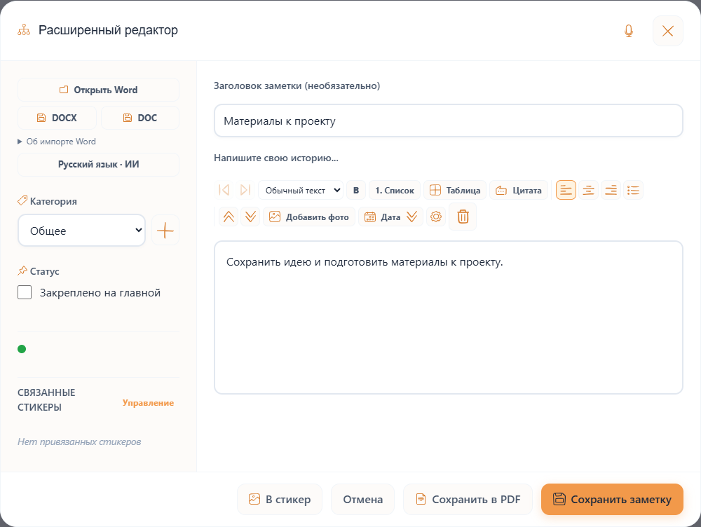
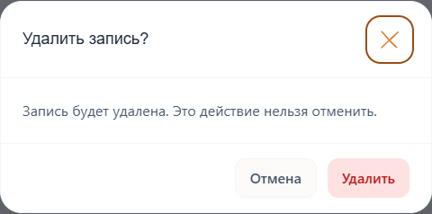
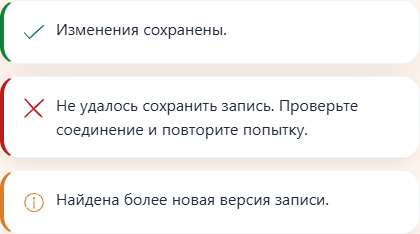
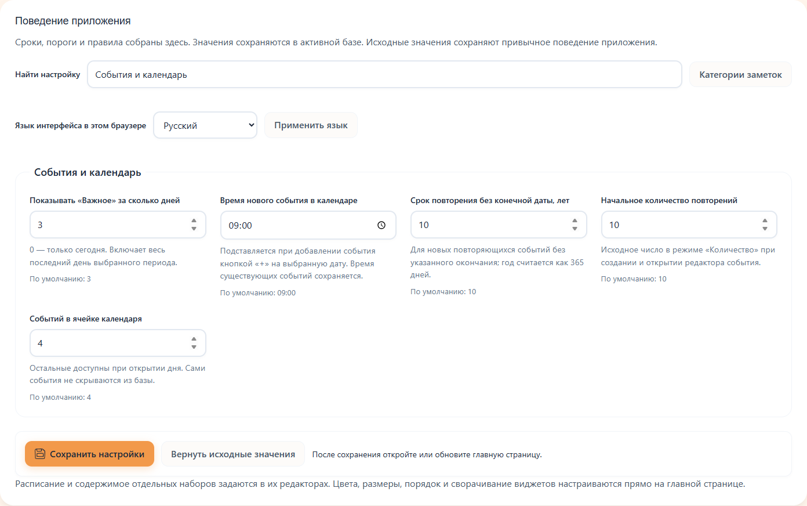
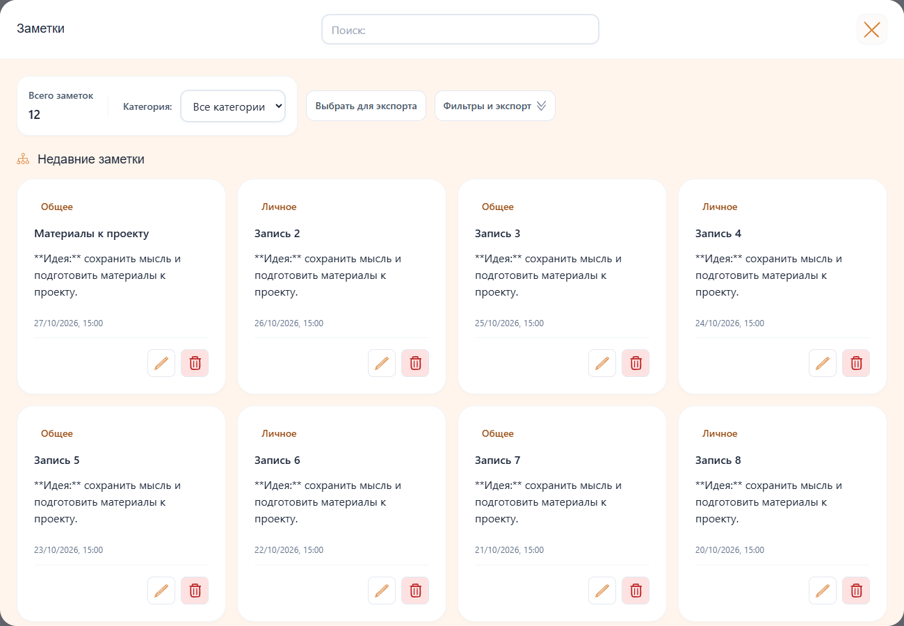
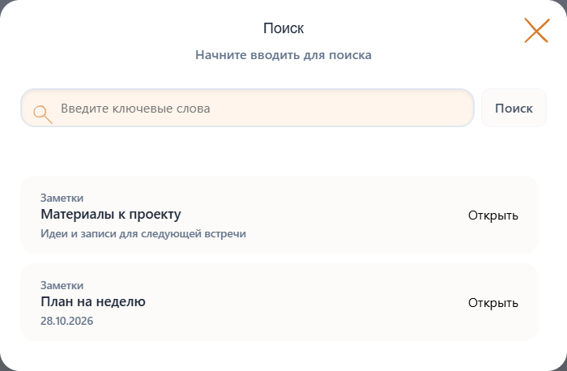

# Дизайн система на основе papanda

Базовая система от 28 октября 2026 года, версия 0.7.167. papanda — приложение для
тайм-менеджмента и исходный образец для семейства приложений автора.
Общий стиль должен узнаваться в приложениях с разными задачами и устройством экранов.

## Характер интерфейса

Характер: **тёплое личное рабочее пространство**.
Светлый персиковый фон, белые поверхности, мягкие тени и оранжевые контуры
делают интерфейс дружелюбным. Спокойные заголовки, читаемый текст и компактные
действия оставляют основное внимание содержимому пользователя.

Сохраняем сложившуюся основу papanda. Общие правила касаются
читаемости, согласованности компонентов и ясности состояний. Основные компоненты внедрены в приложение и проверены на реальных шаблонах
с вымышленными данными. Новые варианты оцениваем на характерном экране.

## Общее для семейства приложений

| Область | Общее правило | Что может различаться |
|---|---|---|
| Цвет | Тёплый фон, белые поверхности, оранжевое действие, серо-синий текст | Цвета категорий и предметных данных |
| Геометрия | Радиусы 8, 12, 18 и 24 px; отступы по общей шкале | Размеры и пропорции содержательных областей |
| Шрифты | Inter для интерфейса, Outfit для заголовков, системные замены | Специальный шрифт чтения или редактора |
| Значки | Doodle как исходный набор; одинаковая трактовка действий | Пользовательский выбор другого набора, уже поддерживаемый papanda |
| Действия | Одинаковые роли кнопок, фокус, загрузка, ошибка и сохранение | Состав действий и названия предметных сущностей |
| Компоновка | Ясная иерархия и доступные основные действия | Панели, таблицы, карточки, навигация и плотность |

Сетка виджетов, бумажные стикеры и общий ввод papanda относятся к её сценарию.
Другому приложению не требуется воспроизводить их ради визуального сходства.
Замена общего оранжевого акцента пока не входит в предложенные вариации семейства.

## Цветовые роли

Точные значения и роли находятся в [tokens.json](tokens.json).
Исходные значения взяты из [variables.css](source/fastapi_app/static/css/base/variables.css).

| Роль | Значение | Применение |
|---|---|---|
| Фон | `#FFF5EC` | Рабочая область |
| Поверхность | `#FFFFFF` | Карточки, поля, окна |
| Вторичная поверхность | `#FDFBF9` | Спокойные вспомогательные области |
| Акцент | `#F2994A` | Заливка основного действия и декоративные акценты |
| Тёмный акцент | `#D87D2D` | Наведение заливки и контурные значки |
| Мягкий акцент | `#FFF3E0` | Выбранная область и ненавязчивая подсветка |
| Основной текст | `#1E293B` | Содержимое и подпись на оранжевой кнопке |
| Текст описания | `#475569` | Описание и вспомогательная информация |
| Вторичный текст | `#64748B` | Даты и метаданные |
| Текст ссылки | `#9A4D13` | Тёмно-оранжевый для небольшого текста |

Белый текст на `#F2994A` имеет контраст около 2,23:1. Используем прежнюю заливку и `#1E293B` с контрастом 6,57:1.
Контурный `#D87D2D` на белом даёт 3,05:1; для небольших текстовых ссылок
используем `#9A4D13` с контрастом 6,10:1. Это расчёты для указанных сплошных
цветов, а не подтверждение доступности всех существующих экранов.

## Эталоны компонентов

Образец показывает тёмную подпись на оранжевой кнопке.
Карточка и форма используют общие поверхности, шрифты и скругления.

| Компонент | Эталон | Состояния |
|---|---|---|
| Основная кнопка | Оранжевая, тёмная подпись, радиус 12 px, высота от 44 px | Обычная, наведение, фокус, нажатие, сохранение, недоступна |
| Вторичная кнопка | Спокойная светлая поверхность, тёмная подпись | Те же состояния без акцентной заливки |
| Поле | Белая поверхность, радиус 12 px, постоянная видимая подпись | Пустое, заполненное, фокус, ошибка, недоступно |
| Карточка | Белая, радиус 24 px, мягкая тень, внутренний отступ 24 px | Обычная, выбранная, пустая |
| Строка списка | Содержимое и метаданные отделены, действия предсказуемы | Обычная, выбранная, выполненная |

Рядом с ошибкой объясняем способ исправления. Placeholder дополняет подпись поля.
Для отправки формы явно показываем ожидание и блокируем повторную отправку;
при ошибке сохраняем введённый текст. Успешное сохранение подтверждаем текстом.
Цвет состояния сопровождаем подписью или знаком.

Заголовки компонентов — 18 px, вес 500; основной текст — 16 px, подписи — 14 px.
Вес 600–700 используем для действий и локального выделения.
Текст обычных записей в полях набираем шрифтом интерфейса Inter с системными
заменами. Моноширинный шрифт оставляем для содержимого, которому он нужен,
например кода.

Шкала отступов
4, 8, 12, 16, 24, 32 и 48 px — общая шкала. В содержательных областях допустимы
обоснованные локальные значения. Для плотных панелей допускаются компактные
элементы при сохранении удобной области нажатия на сенсорных устройствах.

При наведении не сдвигаем текст и соседние элементы. Сохраняем мягкую реакцию
цвета, границы или тени. Для уменьшенного движения отключаем необязательные
перемещения. Различимые фокус и состояния важнее декоративной анимации.

## Применение в приложении

Общий класс `record-form` и [record_form.css](source/fastapi_app/static/css/components/record_form.css)
используют восемь окон: задача, привычка, Wink, хронология, заметка,
создание и редактирование занятия, событие. Для события предусмотрен вариант
`record-form-stacked` с одной основной колонкой. Действия сохраняют текстовые
подписи через `data-keep-label`; панели инструментов редактора остаются компактными.

В этих окнах применены тёмная подпись основной кнопки, обычный шрифт интерфейса,
поля и скругления по общей системе. Нативные флажки задач, привычек и заметок
доступны с клавиатуры. Выбранная дата Flatpickr использует общий оранжевый акцент.

## Служебные окна и уведомления

Подтверждение, ввод значения и выбор варианта используют общую основу
`record-form system-dialog` и [system_dialog.css](source/fastapi_app/static/css/components/system_dialog.css).
Обычная ширина окна — до 480 px. Основное действие оранжевое с тёмной подписью;
удаление — с красной подписью на мягком красном фоне. В подтверждении и выборе
первый фокус получает отмена; в запросе значения — поле ввода.
Нативные подтверждения поверх чтения, линии жизни и фотодоски используют
те же правила и сохраняют своё положение над родительским окном.

Уведомление — белая поверхность с радиусом 18 px, обычным текстом 16 px и
значком состояния. Ширина ограничена 420 px и доступной шириной экрана.
Успех, ошибка и информация различаются знаком и цветом. Ошибка получает
роль `alert`, остальные сообщения — `status`. Учитывается уменьшенное движение.

## Настройки

Страница настроек использует класс `settings-page`: поля, основные кнопки и
фокус берутся из общей основы редакторов. Заголовки групп — 18 px, вес 500;
подписи полей — 14 px, вес 500; значения — 16 px обычным шрифтом интерфейса.
В таблице резервных копий используется компактный вариант действий высотой
от 36 px. Выбор значков сохраняет отдельные карточки с образцами.

Рабочая область ограничена 1600 px. На ширине до 768 px панели располагаются
в потоке страницы с автоматической высотой, чтобы подвал оставался под ними.
Действия и поля загрузки переносятся. Ошибки сохранения используют тёмный
красный цвет и текстовое пояснение.

## Списки и просмотр записей

Браузер записей использует `record-browser`: белые карточки на тёплом фоне,
заголовки 18 px, текст 16 px, метаданные 14 px. Фильтры и поиск имеют высоту
44 px; действия карточек используют компактный вариант. Таблица событий
прокручивается внутри своей области на узком экране. Окно просмотра записи
использует `record-form record-detail` с отдельной спокойной областью чтения.

Escape сначала закрывает вложенный редактор или меню инструментов, затем
браузер записей. Категории, календарные цвета и пользовательские метки сохранены.

## Общая основа и навигация

Общие кнопки, поля и заголовки окон используют те же роли, что редакторы.
`--color-on-primary`, `--color-accent-text` и `--color-focus` задают подписи
на акценте, ссылки и фокус. Обычный редактор по умолчанию использует Inter;
явно выбранная пользователем тема редактора и специальный код сохраняют свой шрифт.

Обычная кнопка имеет высоту от 44 px, `btn-sm` — от 36 px, значок — 36 px,
а `.widget-actions .btn-icon` — компактный вариант 32 px. Для сенсорного
указателя значки и закрытие получают область от 44 px. Навигация выделяет
выбранный пункт мягким оранжевым фоном и тёмной подписью. Флажки повторения
остаются нативными элементами с видимым фокусом. Результат поиска — кнопка,
доступная с клавиатуры. Заголовки и действия вспомогательных окон наследуют
общую основу; содержательные области чтения, линии жизни и фотодоски сохраняют
свою компоновку.

При подключении нового редактора исключайте его из прежних правил
горизонтальных редакторов и проверяйте специальные поля, действия и мобильную компоновку.

## Комплект для передачи

Соберите архив командой `python -B scripts/export_design_system.py` из корня
репозитория. Она использует только стандартную библиотеку Python, читает
явный список исходников и не обращается к базе. Готовый архив находится в
`artifacts/papanda-design-system-0.7.167.zip` для этой версии.

Распакуйте архив и откройте `index.html`: это работающий каталог полей,
кнопок, карточек, таблицы, подтверждения, ошибок, ожидания и пустого состояния.
`papanda.css` собран из настоящих общих токенов и контролов papanda, к которым
добавлены переносимые правила компоновки. Его можно подключить к новому
веб-приложению целиком или перенести роли в компоненты другого стека.
Это начальная основа для нового проекта; общие имена `.btn` и `.form-input`
при внедрении в существующее приложение следует согласовать с его стилями.

Архив содержит эти документы, `tokens.json`, эталонные снимки, исходники CSS
в `source/`, зафиксированные значки в `icons/` и лицензии. `manifest.json`
указывает версию системы, Git-источник и SHA-256 каждого файла. Сравнивайте
хэши при передаче и сохраняйте номер основы в другом проекте. Корневой
`LICENSE` относится к материалам papanda, лицензия CC0 значков описана в
`icons/README.md` и `icons/manifest.json`.

Файлы шрифтов в архив не включены: каталог работает без сети с системными
заменами. Для точного воспроизведения подключите Inter 400–700 и Outfit 400–700
в своём приложении, сохранив системные замены и настройки пользователя.

История внедрения и проведённые проверки описаны в [audit.md](audit.md).
Специализированные области — бумажные стикеры, канвас фотодоски, временная шкала,
чтение, графики и пользовательские цветовые метки — сохраняют свои предметные
правила. Их геометрию не следует переносить в другое приложение автоматически.
Базовая унификация не является проверкой всех возможных данных, плагинов и
состояний доступности. Изменения дополнительных сценариев проверяйте отдельно.

Для агента другого приложения используйте [AGENT.md](AGENT.md). Документы с
ссылками за пределы папки показывают происхождение в papanda; в архиве исходные
общие стили доступны также в `source/`. Ранний `prompt-library/papanda/VISUAL.md`
описывал воспроизведение приложения. При расхождениях общих ролей используйте
эту систему; особенности предметных экранов уточняйте по действующему коду.
