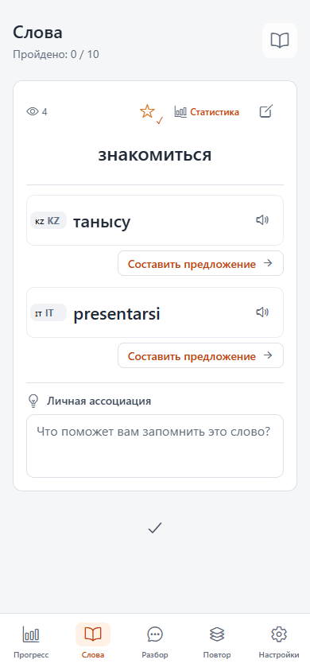
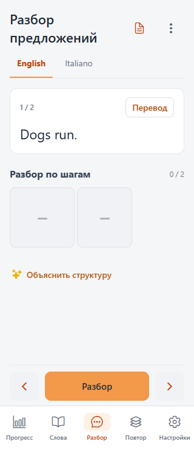
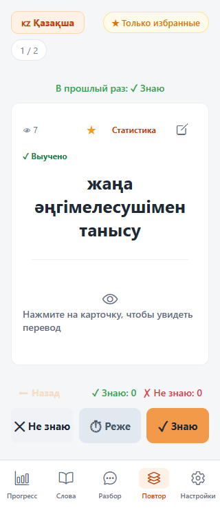
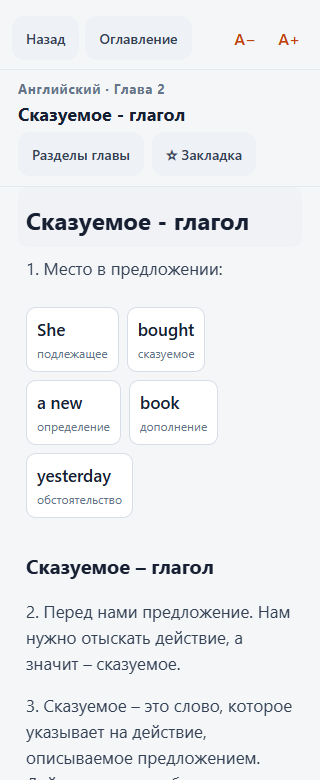
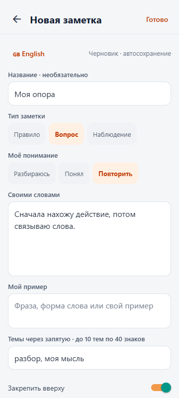

# Мобильное оформление для чтения — 29 октября 2026

Запрос владельца: сделать интерфейс строже, сохранить оранжевый акцент,
исключить бежевый фон, согласовать размеры элементов и удобство чтения.
Правила текущей темы и происхождение справочного комплекта:
[DESIGN_SYSTEM.md](../DESIGN_SYSTEM.md).

## Что изменено

Светло-серый фон и белые поверхности, небольшие скругления, единая системная
гарнитура, контурные значки, пять равных подписанных пунктов навигации.
Основной текст пояснений — 16/25 px, заголовки — 22/30 px, учебные слова —
22–26 px. Оранжевые кнопки используют тёмные подписи. Согласованная владельцем
компактная галочка «Выучено» сохранена.

Убраны декоративные тени и вращение карточки при свайпе. Закрытые блоки
предложения резервируют ту же геометрию, что открытые: раскрытие не меняет
положение соседних слов. Скрытый текст исключён из дерева доступности.
Длинные предложения и низкие экраны используют прокрутку, а не уменьшение
шрифта. Двойные рамки частей предложения и предметные цвета ролей сохранены.
Панель действий тренировки выровнена; её сенсорные области не перекрываются.
Прогресс, очередь упражнений и сохранение пользовательских данных не изменены.

## Проверка

- Обязательный npm run check: книга, типы приложения и прокси, 248 тестов — успешно.
- После последних правок повторены типы и проверка diff на ошибки пробелов.
- Итоговый веб-экспорт: dist/reading-final, успешно. Для тестов использован
  адрес smoke.invalid; все внешние запросы перехватывались, данные вымышленные.
- Семь существующих сценариев на итоговом бандле: papanda-design, trainer,
  review, notes, book, statistics, workshop — успешно.
- Оформление: 320/390/1440 px, равные области навигации, перенос длинных слов,
  текст ×1,5, поле ассоциации и сохранение после перезапуска, фокус клавиатуры,
  уменьшенная высота, пустое состояние, ожидание и ошибка объяснения с повтором.
- Тренажёр: размеры и положения блоков до/после раскрытия, размеры при включении
  перевода, раскрытие и повтор, листание, доступность последнего блока длинного
  предложения при прокрутке, карточки/таблица, двойные рамки.
- Книга: 66 глав на ширине 320 px, таблицы, поиск, закладки, возврат к чтению,
  настройка шрифта, разделы и переходы к объяснениям.

На Android/iOS не проверены установленное приложение, экранная клавиатура,
TalkBack/VoiceOver и системное увеличение шрифта. APK не собирался.

## Снимки итоговой версии

### Слова, 390 px

### Разбор, 320 px

### Тренировка, 320 px, длинное казахское выражение

### Чтение книги, 320 px

### Заметка

